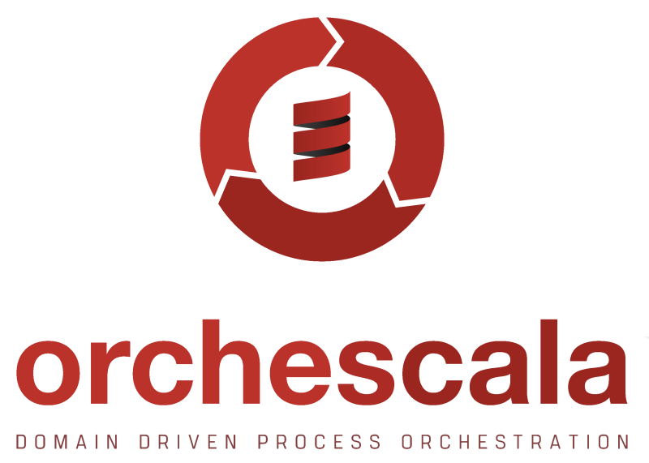

[](https://github.com//pme123/orchescala/actions/workflows/ci.yml)


## Description
See [Documentation](https://pme123.github.io/orchescala/)

For details on Bearer token authentication, see the [Gateway README](06-gateway/README.md#authentication).

Test your DMN tables with the [DMN Tester](04-dmntester-server/README.md) -
`sbt dmnTester` starts it with the examples of this repository.

# Development

## Update Dependencies

Use https://github.com/kitlangton/given

## Releasing
Just run `./helper.scala VERSION`.

## Local publish

`sbt publishLocal`

## Tests with Docker

`persistencePostgres/test` runs the store against Postgres with [Testcontainers](https://java.testcontainers.org).
Without Docker these tests are ignored locally (on CI they fail).
With [Colima](https://github.com/abiosoft/colima) Testcontainers does not find the Docker socket by itself:

```bash
export DOCKER_HOST=unix://$HOME/.colima/default/docker.sock
export TESTCONTAINERS_DOCKER_SOCKET_OVERRIDE=/var/run/docker.sock
sbt persistencePostgres/test
```

## Documentation
The pages are markdown files in [00-docs/src/docs](00-docs/src/docs). A small Vite/React app in
[00-docs](00-docs) renders them - see [00-docs/README.md](00-docs/README.md).

Preview:  `cd 00-docs && npm install && npm run dev` - then http://localhost:3020/orchescala/

We use [mdoc](https://scalameta.org/mdoc/) to compile the Scala snippets (` ```scala mdoc `): `sbt docs/mdoc`

## License
This project is licensed under the MIT License - see the [LICENSE](LICENSE) file for details.

Exception: the documentation apps **Orch Doc** (`04-orch-doc`), **Orch Spec** (`04-orch-spec`) and **Orch Ops** (`04-orch-ops`)
- and the `orchescala-orch-doc` artifact built from them - are licensed under the
[Business Source License 1.1](04-orch-doc/LICENSE) by z9nai GmbH: free for non-production use,
production use with a license from z9nai GmbH.